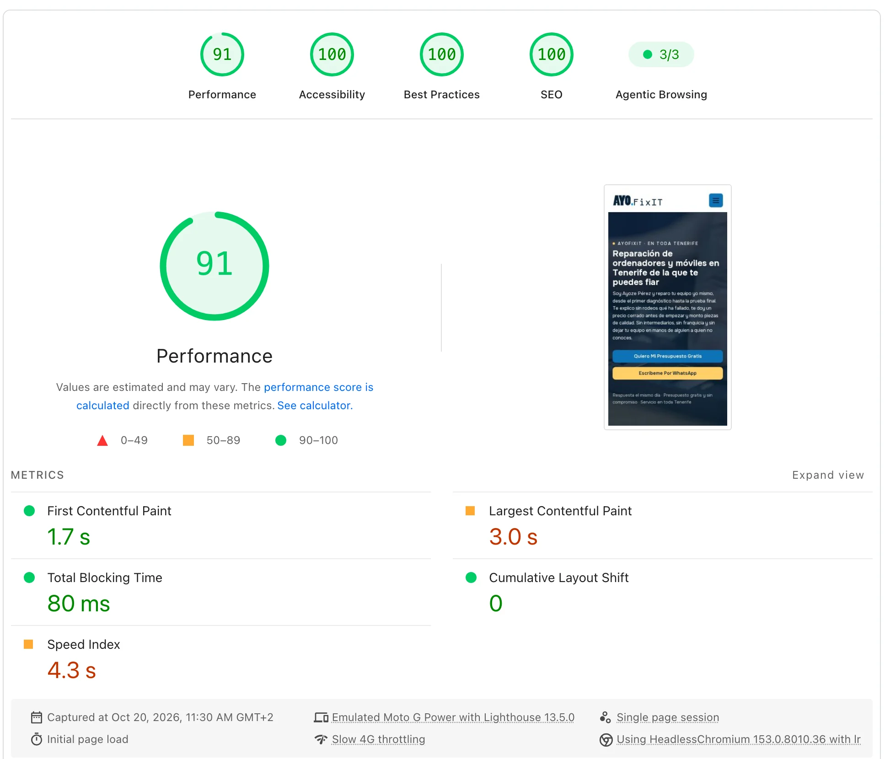

# AYOFixIt — Computer & Mobile Repair in Tenerife

Website of **AYOFixIt**, the one-man repair workshop of Ayoze Pérez: computers, laptops, phones and tablets, island-wide across Tenerife.


## What it is

A static, eleven-page marketing site in English. Plain HTML, one stylesheet of our own and a handful of vanilla-JS files — **no build step, no bundler, no framework, no dependencies to install**. The markup began as a commercial HTML template and was stripped down to what this site actually uses.

- **Nothing to deploy, anywhere to deploy it.** Every link, asset and canonical is relative, so the same files work from a domain root, from a subfolder or straight off `file://`. The three files that cannot be relative (`sitemap.xml`, `robots.txt`, `llms.txt`) get their absolute URLs stamped by `tools/set-domain.py`.
- **No third-party requests.** Onest is self-hosted next to everything else — video, icons, images, jQuery, GSAP, Lenis, Swiper — all served from the repository. No analytics, no cookies, no embeds.
- **Scroll motion on a single timeline.** Lenis drives the scroll, GSAP `ScrollTrigger` drives everything that reacts to it: per-character heading reveals via `SplitText` with `scrub`, a lateral `clipPath` wipe on photos, and the section entrances. The whole block sits behind a `prefers-reduced-motion: reduce` guard.
- **Each page loads only what it uses.** Swiper ships with the home page alone and Bootstrap's JS only where there is an accordion; the counters run on an `IntersectionObserver` of a dozen lines instead of counterUp plus Waypoints. About and contact pull nine scripts; the home page, twelve.
- **Self-hosted hero video** with `playsinline` plus a small retry loop, because iOS refuses to autoplay in low power mode and after a bfcache restore.
- **Custom cursor only where there is a cursor.** The pointer effect is gated behind `(hover: hover) and (pointer: fine)`, so it never appears on a touch screen.
- **SEO.** A JSON-LD `@graph` per page (`WebSite`, `LocalBusiness` with the eight Facebook reviews and their aggregate rating, `WebPage`, and `FAQPage` on the pages that answer questions), relative canonicals, `sitemap.xml` and an `llms.txt` descriptor.
- **No forms, no backend.** Every call to action is a WhatsApp deep link, a `tel:` or a `mailto:`.

## Speed

Live reports, re-run whenever you want a fresh number:

- [PageSpeed Insights — mobile](https://pagespeed.web.dev/analysis/https-www-ayofixit-com/vvbo8i1hj3?form_factor=mobile)
- [PageSpeed Insights — desktop](https://pagespeed.web.dev/analysis/https-www-ayofixit-com/vvbo8i1hj3?form_factor=desktop)



*Mobile report of 20 October 2026: LCP 3.0 s, FCP 1.7 s, TBT 80 ms, CLS 0, on a throttled Moto G Power over slow 4G.*

A repair shop gets found on a phone, often on mobile data, so the budget is spent where it shows: nothing third-party on the critical path, the hero image preloaded with `fetchpriority="high"` so the LCP starts downloading from the first bytes of HTML, photography in WebP with `srcset` so a 600 px card never pulls a 1200 px file, and Font Awesome cut down to the ten glyphs the site actually draws — 1.5 KB of font instead of 260 KB. Bootstrap is pruned to the rules these pages use, which takes the blocking CSS from 64 KB to 20 KB compressed.

Caching is the other half: assets are served `immutable` for a year, which is only safe because `tools/stamp-assets.py` rewrites every asset url to `?v=<commit>` during the deploy. The HTML itself is never cached (`max-age=0, must-revalidate`), so a new deploy reaches a returning visitor on the first request.

Two things are deliberately left on the table. The scroll choreography (GSAP, ScrollTrigger, SplitText, Lenis) costs around 60 ms of forced reflow, and Swiper ships whole rather than as a custom build. Both are a design decision, not an oversight: the motion is the point of the page.

## Layout

```
index.html              # home: hero video, services, testimonials, FAQ
about.html              # faqs.html, contact.html, 404.html
services/index.html     # the services listing
services/<service>.html # computer-hardware, battery-replacement, custom-pc-builds,
                        # laptop-screen-replacement, software-troubleshooting
css/custom.css          # the site's own stylesheet (theme CSS, pruned)
css/bootstrap.min.css   # grid and utilities
css/swiper-bundle.min.css · mousecursor.css
js/function.js          # all of this site's behaviour: menu, slider, counters,
                        # scroll choreography, hero video
js/lenis.min.js         # smooth scroll
js/gsap.min.js · ScrollTrigger.min.js · SplitText.min.js
js/jquery-3.7.1.min.js · bootstrap.min.js · jquery.slicknav.js ·
js/swiper-bundle.min.js · magiccursor.js
images/                 # photography, service shots, icons, favicons, open graph
images/reviews/         # avatars of the eight Facebook reviewers
webfonts/               # Onest (latin subset) and a 10-glyph cut of Font Awesome
videos/hero-video-1.mp4 # hero background
tools/set-domain.py     # stamps the live domain into the absolute-URL files
tools/stamp-assets.py   # stamps ?v=<commit> on every asset url at deploy time
_headers                # one-year immutable caching, safe thanks to that stamp
sitemap.xml · robots.txt · llms.txt
docs/screenshot.png · pagespeed-mobile.webp    # the images in this file
```

## Running it locally

No install, no build. Opening `index.html` in a browser works, and so does a server if you prefer one:

```bash
python3 -m http.server 8080
```

URLs keep their `.html`, so nothing needs a host that resolves extensionless paths.

## Publishing

Upload the repository as-is. Before the first publish, stamp the domain:

```bash
python3 tools/set-domain.py https://tudominio.com
```

That rewrites the canonical and `og:` tags of all eleven pages, `sitemap.xml`, the `Sitemap:` line in `robots.txt` and the links in `llms.txt`, deriving each page's path on its own (`services/index.html` → `/services/`). Re-run it whenever the site moves; it replaces whatever domain is in there now.

If the site lives in a subfolder, pass the full base (`https://host/projects/ayofixit`) — the pages work either way, the stamped files need the whole prefix.

**The share image is the one tag that breaks on a move.** Crawlers do not resolve a relative `og:image`, so it needs a host that stays put:

```bash
python3 tools/set-domain.py --image https://host-estable/open-graph.jpg
```

That touches only `og:image` and `twitter:image` and leaves the rest relative.

## Things that will bite you

- **Never `gsap.from()` with a ScrollTrigger here.** A `from()` tween re-applies its starting state on every `ScrollTrigger.refresh()`, which strands elements at `autoAlpha: 0` — photos and whole sections silently stop rendering. Use `gsap.set()` followed by `gsap.to()`, as `js/function.js` does throughout.
- **Nothing may depend on the native scroll event.** Lenis replaces it. WOW.js used to animate the `.wow` sections and broke exactly this way; those entrances now run through ScrollTrigger, and the `.wow` class survives only as a hook.
- **`prefers-reduced-motion` is a real code path**, not a nicety: `.reveal` figures start at `visibility: hidden` in CSS, so that branch has to make them visible or the photos never appear.
- **A host behind HTTP basic auth kills every social preview.** Facebook, WhatsApp and the meta validators fetch the page anonymously; a `401` reads to them as a broken `og:image`, with no hint about the real cause.
